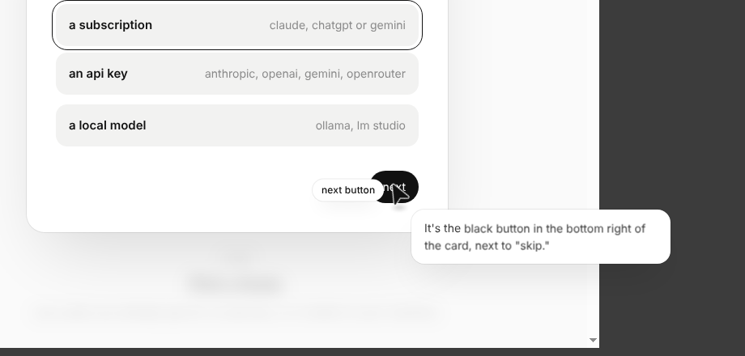
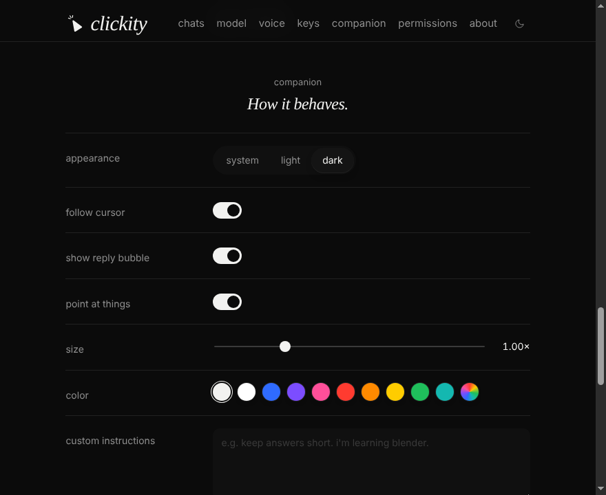

<p align="center">
  
</p>

<h1 align="center"><i>clickity</i></h1>

<p align="center">
  a small ai companion that lives next to your cursor.<br>
  hold a key, ask out loud — it looks at your screen, answers, and points the way.
</p>

<p align="center">
  <a href="https://github.com/Bndrwe/clickity/releases/latest/download/Clickity-mac-arm64.dmg"><b>download for mac (m1–m4)</b></a> ·
  <a href="https://github.com/Bndrwe/clickity/releases/latest/download/Clickity-mac-x64.dmg"><b>mac (intel)</b></a> ·
  <a href="https://github.com/Bndrwe/clickity/releases/latest/download/Clickity-win-x64.exe"><b>windows</b></a> ·
  <a href="https://github.com/Bndrwe/clickity/releases/latest/download/Clickity-linux-x86_64.AppImage"><b>linux</b></a>
</p>

<p align="center">
  
</p>

clickity is a little ink triangle that follows your mouse. hold the talk key, say what you need, and let go. it looks at your screens, answers in a short bubble, says it out loud, and — when the answer is something on screen — flies over and points at it.

it's an open-source take on [heyclicky.com](https://heyclicky.com), with one big difference: **you bring your own brain.** use the claude, chatgpt or gemini plan you already pay for, an api key, openrouter, or a model running on your own machine — and pick the model.

## download

| your computer | installer |
|---|---|
| mac with apple silicon (m1, m2, m3, m4) | [Clickity-mac-arm64.dmg](https://github.com/Bndrwe/clickity/releases/latest/download/Clickity-mac-arm64.dmg) |
| mac with intel | [Clickity-mac-x64.dmg](https://github.com/Bndrwe/clickity/releases/latest/download/Clickity-mac-x64.dmg) |
| windows 10 / 11 | [Clickity-win-x64.exe](https://github.com/Bndrwe/clickity/releases/latest/download/Clickity-win-x64.exe) |
| linux (any distro) | [Clickity-linux-x86_64.AppImage](https://github.com/Bndrwe/clickity/releases/latest/download/Clickity-linux-x86_64.AppImage) |
| linux (debian / ubuntu) | [Clickity-linux-amd64.deb](https://github.com/Bndrwe/clickity/releases/latest/download/Clickity-linux-amd64.deb) |

not sure which mac you have? apple menu › **about this mac** › if "chip" says *apple m…*, get the apple silicon one; if it says *intel*, get intel.

all builds: [releases page](https://github.com/Bndrwe/clickity/releases).

### installing

**mac** — open the dmg and drag clickity into applications. clickity isn't notarized by apple yet, so the first launch is blocked ("apple could not verify…"). click **done**, then either:

- open **system settings › privacy & security**, scroll down, click **open anyway** next to clickity, and confirm; or
- run once in terminal: `xattr -dr com.apple.quarantine /Applications/Clickity.app`

**windows** — run the installer. if smartscreen warns, click **more info › run anyway**. you get a start menu and desktop shortcut.

**linux** — make the AppImage executable (`chmod +x Clickity-linux-x86_64.AppImage`) and run it, or install the `.deb`.

### first run

1. pick a brain in the window that opens (see [choosing a brain](#choosing-a-brain)). for a subscription, click **sign in** next to it once.
2. on mac, grant **microphone**, **screen recording** and **accessibility** in settings › permissions, then click **restart clickity**.
3. hold **ctrl + option** (mac) or **ctrl + alt** (windows / linux), say hi, and let go.

clickity behaves like any app: clicking its icon opens settings, the companion keeps running while the window is closed, and you quit with cmd + q, the dock menu, or the menu-bar / tray icon. turn on *launch at login* to have it start quietly.

## how it works

1. you hold the talk key. the companion listens — your voice is turned into text on your machine by default.
2. when you let go, it screenshots each display and sends your words and the screenshots to the model you picked.
3. the reply streams into a bubble and is read out loud.
4. if the model points at something, the companion flies there and lands next to it.

## make it yours

- **look** — light, dark, or follow the system. pick the companion's color and size (0.5×–2.5×).
- **keys** — record any chord for talking and for typing; hold-to-talk or tap-to-toggle.
- **voice** — on-device whisper, openai, groq, gemini or a local server to listen; your system voice, openai or elevenlabs to speak.
- **behavior** — follow the cursor or park in a corner, show or hide the bubble, pointing on or off, custom instructions.

<p align="center">
  
</p>

## choosing a brain

pick one in settings. the setup column is the command or step you need before clickity can use it.

| provider | what you need | setup |
|---|---|---|
| claude | a claude pro or max plan | `npm i -g @anthropic-ai/claude-code && claude` |
| chatgpt | a chatgpt plus or pro plan | `npm i -g @openai/codex && codex login` |
| gemini (subscription) | a google account with an ai pro plan | `npm i -g @google/gemini-cli && gemini` |
| anthropic api | an anthropic api key | paste the key in settings (console.anthropic.com) |
| openai api | an openai api key | paste the key in settings (platform.openai.com) |
| gemini api | a google ai studio key | paste the key in settings (aistudio.google.com) |
| openrouter | an openrouter key | paste the key in settings (openrouter.ai) |
| local | ollama, lm studio, or any openai-compatible server | start the server; the default base url is `http://localhost:11434/v1` |

the three subscription options run the vendor's own cli on your machine, in headless mode. that means each request counts against your plan's usage, and it is subject to each vendor's terms. clickity does not get a separate allowance or bypass any limit.

see [docs/PROVIDERS.md](docs/PROVIDERS.md) for sign-in steps, model ids and cost notes.

## models

each provider has a default model, so you can start without choosing one. the model picker in settings lists what the provider offers. for local models, use a vision model if you want the companion to see your screen. see the notes in `docs/PROVIDERS.md`.

## voice

speech to text (stt) options:

- **on-device** (default): whisper running in the app, through transformers.js. free, private, no key, works with any brain. the default model is `Xenova/whisper-base.en`.
- **openai**, **groq**: whisper over https. uses the openai key you already set, or a key you enter here.
- **gemini**: gemini audio understanding, using the gemini api key.
- **local**: any openai-compatible `/audio/transcriptions` server, such as whisper.cpp or speaches.

text to speech (tts) options:

- **system** (default): the operating system voice. no key needed.
- **openai**, **elevenlabs**: higher quality voices over https. elevenlabs needs its own key.
- **off**: the companion only shows the reply in the bubble.

the speaking rate is adjustable in settings.

## keys

- **talk key**: default ctrl + option on mac, ctrl + alt on windows. change it in settings by recording a new chord.
- **hold or toggle**: in *hold* mode, the companion listens while you hold the chord and sends when you let go. in *toggle* mode, press once to start and again to send.
- **type instead**: ctrl + alt + space opens a small text box next to the companion, for when you would rather type.
- **escape** cancels the current turn.

## permissions

**macos** asks for three things, all in system settings → privacy & security:

- **microphone**: asked the first time you hold the talk key. the app declares why it needs it.
- **screen recording**: needed to capture your displays when you press the talk key. without it, the companion can still talk, but it cannot see the screen.
- **accessibility**: needed for real hold-to-talk, because the app has to see when you let go of the chord. without it, the chord falls back to a toggle, so you press once to start and once to send.

**windows** needs microphone access, which you can allow under settings → privacy & security → microphone. nothing else needs a separate prompt.

## privacy

- screenshots are only taken when you press the talk or type chord. nothing is captured in the background.
- screenshots and your words go only to the provider you chose. with on-device speech to text, your voice never leaves your machine.
- the screenshots are saved as temporary files for the turn. they are deleted after about two minutes.
- api keys are encrypted with the operating system's keychain, through electron's safeStorage. if safeStorage is not available on your system, the app stores keys unencrypted and logs a warning.

## pointing

the model can end a reply with pointing tags, such as `[POINT:x,y:label:screen1]`. the coordinates are pixels in the screenshot it was sent for, and the screen number matches the order the screenshots were sent in. the app converts those pixels to a position on your display, flies the companion there, and shows the label beside it. the tags are removed before the reply is shown or spoken, so you never see them. if the model has nothing to point at, it writes `[POINT:none]`. pointing can be turned off in settings.

## troubleshooting

- **"cli not found" for a subscription provider**: the app cannot find `claude`, `codex` or `gemini` on its path. open settings, find the provider, and set the cli path to the full path of the binary (run `which claude` in a terminal to get it).
- **the cli works in a terminal but not when the app is opened from finder or the dock**: on mac, apps started from finder do not inherit the path from your shell profile. a cli installed through nvm or a global npm prefix is often missing from that path. set the cli path, as above.
- **the talk key does nothing on linux**: global key handling works best on x11. on wayland, the compositor may block global shortcuts entirely, or only deliver key presses and not releases. in that case the chord acts as a toggle, or it may not trigger at all. linux support is best-effort and targets x11.
- **the companion can talk but cannot see the screen**: check screen recording permission on mac. on other systems, check that your model is a vision model.

## build from source

you need node.js 20+ and npm.

```sh
git clone https://github.com/Bndrwe/clickity.git
cd clickity
npm install
npm run dev
```

`npm run dev` builds the app and starts it in electron. to package an installer for your own system, run `npm run dist` — the builds land in `release/`. installers for every platform are built by github actions (`.github/workflows/release.yml`) on each `v*` tag, or on demand from the actions tab.

the icons are generated: run `node scripts/make-icons.mjs` after changing the shape.

## credits

inspired by [heyclicky.com](https://heyclicky.com). clickity is not affiliated with it.

## license

MIT. see [LICENSE](LICENSE).
