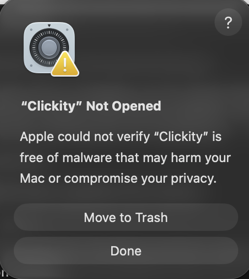
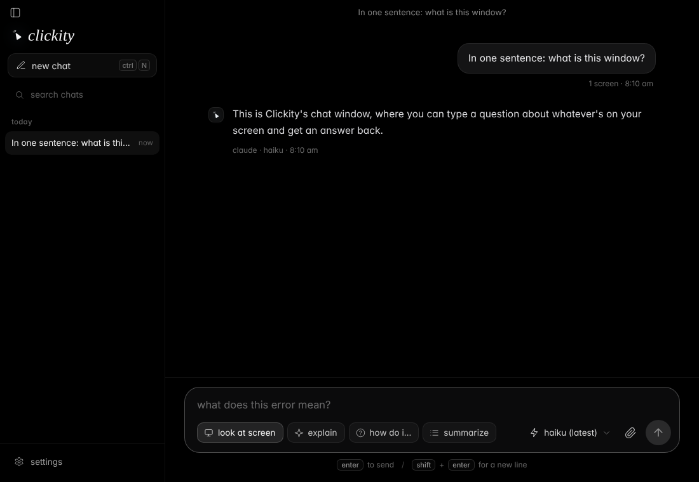

<p align="center">
  <picture>
    <source media="(prefers-color-scheme: dark)" srcset="assets/logo-dark.svg">
    
  </picture>
</p>

<h3 align="center"><i>clicky, but free &amp; open source.</i></h3>

<p align="center">
  a small ai companion that lives next to your cursor.<br>
  hold a key, ask out loud — it looks at your screen, answers, and points the way.
</p>

<p align="center">
  <a href="https://github.com/Bndrwe/clickity/releases/latest/download/Clickity-mac-arm64.dmg"><b>download for mac (m1–m4)</b></a> ·
  <a href="https://github.com/Bndrwe/clickity/releases/latest/download/Clickity-mac-x64.dmg"><b>mac (intel)</b></a> ·
  <a href="https://github.com/Bndrwe/clickity/releases/latest/download/Clickity-win-x64.exe"><b>windows</b></a> ·
  <a href="https://github.com/Bndrwe/clickity/releases/latest/download/Clickity-linux-x86_64.AppImage"><b>linux</b></a>
</p>

<p align="center">
  
</p>

clickity is a little ink triangle that follows your mouse. hold the talk key, say what you need, and let go. it looks at your screens, answers in a short bubble, says it out loud, and — when the answer is something on screen — flies over and points at it.

it's [clicky](https://heyclicky.com), but free and open source — no subscription to clickity itself, no message limits, MIT licensed. and one big difference: **you bring your own brain.** use the claude, chatgpt or gemini plan you already pay for, an api key, openrouter, or a model running on your own machine — and pick the model.

## download

[](https://github.com/Bndrwe/clickity/releases/latest)

these links always download the latest release. every change to clickity ships as a new version (v1.0.N), and the app [updates itself](#updates).

| your computer | installer |
|---|---|
| mac with apple silicon (m1, m2, m3, m4) | [Clickity-mac-arm64.dmg](https://github.com/Bndrwe/clickity/releases/latest/download/Clickity-mac-arm64.dmg) |
| mac with intel | [Clickity-mac-x64.dmg](https://github.com/Bndrwe/clickity/releases/latest/download/Clickity-mac-x64.dmg) |
| windows 10 / 11 | [Clickity-win-x64.exe](https://github.com/Bndrwe/clickity/releases/latest/download/Clickity-win-x64.exe) |
| linux (any distro) | [Clickity-linux-x86_64.AppImage](https://github.com/Bndrwe/clickity/releases/latest/download/Clickity-linux-x86_64.AppImage) |
| linux (debian / ubuntu) | [Clickity-linux-amd64.deb](https://github.com/Bndrwe/clickity/releases/latest/download/Clickity-linux-amd64.deb) |

not sure which mac you have? apple menu › **about this mac** › if "chip" says *apple m…*, get the apple silicon one; if it says *intel*, get intel.

every version: [releases page](https://github.com/Bndrwe/clickity/releases).

### installing

**mac** — open the dmg and drag clickity into **applications**.

#### "clickity" not opened? that's expected

the first time you open clickity, macos shows this:

<p align="center">
  
</p>

this happens because clickity isn't notarized by apple: that needs a paid apple developer account, and it's a free open-source app. nothing is wrong with your download. **don't click move to trash** — click **done**, then pick one of these:

**option a: system settings (no terminal)**

1. click **done** on the dialog.
2. open **system settings › privacy & security**.
3. scroll down to **security**. you'll see *"clickity" was blocked to protect your mac*. click **open anyway**.
4. enter your password (or use touch id), then click **open anyway** in the dialog that follows.

clickity opens, and macos remembers your choice — you only do this once per install.

**option b: one terminal command**

open **terminal** and run:

```sh
xattr -dr com.apple.quarantine /Applications/Clickity.app
```

then open clickity normally. this removes the "downloaded from the internet" flag macos puts on the app.

> don't see **open anyway**? it only shows for about an hour after you tried to open the app — open clickity once more, click **done**, and look again. if clickity isn't in applications yet, drag it there from the dmg first; apps run straight from the dmg can't be approved.

after it opens, grant **microphone**, **screen recording** and **accessibility** in settings › permissions, then click **restart clickity**.

**windows** — run the installer. if smartscreen warns, click **more info › run anyway**. you get a start menu and desktop shortcut.

**linux** — make the AppImage executable (`chmod +x Clickity-linux-x86_64.AppImage`) and run it, or install the `.deb`.

### first run

1. pick a brain in the window that opens (see [choosing a brain](#choosing-a-brain)). for a subscription, click **sign in** next to it once.
2. on mac, grant **microphone**, **screen recording** and **accessibility** in settings › permissions, then click **restart clickity**.
3. hold **control + fn** (mac; fn is the globe key on newer keyboards) or **ctrl + alt** (windows / linux), say hi, and let go.

clickity behaves like any app: clicking its icon opens settings, the companion keeps running while the window is closed, and you quit with cmd + q, the dock menu, or the menu-bar / tray icon. turn on *launch at login* to have it start quietly.

### updates

no need to come back here for new versions. clickity checks github for the latest release a few seconds after it starts and every 4 hours after that. when there's a newer one, a small **update to v1.0.N** button appears in the top-right corner of the settings and chats windows (and in the tray menu). click it: clickity downloads the new version, swaps it in and restarts — that's it. settings › about shows your version, a **check for updates** button and what changed.

- **mac** — the new app replaces the old one where it lives (usually applications). macos ties privacy permissions to the app's signature, and every clickity build has a new one, so after an update the talk key or the mic may stop working even though the switches look on. settings › permissions › **reset permissions** fixes it (clickity reminds you once after each update). if clickity runs straight from the dmg or downloads, move it to applications first.
- **windows** — the installer runs silently and reopens clickity.
- **linux** — the AppImage is replaced in place and reopened. with the .deb, the new package opens in your software installer; finish it there.

## how it works

1. you hold the talk key. the companion listens — your voice is turned into text on your machine by default.
2. when you let go, it screenshots each display and sends your words and the screenshots to the model you picked.
3. the reply streams into a bubble and is read out loud.
4. if the model points at something, the companion flies there and lands next to it.

### circle while you talk

while you hold the talk key, move your mouse around the thing you mean: circle it, underline it, or just rest the cursor on it. a thin ink line follows your cursor (tiny wiggles are ignored), and it is drawn into the screenshot too, so the model sees exactly what you marked. clickity also tells the model where you circled and where your cursor ended, so "what is this?" or "make that bigger" means the thing you marked. the line fades once the screenshots are taken. typed questions include your cursor position as well.

### follow-ups and choices

when clickity needs you to decide something (several files match, a risky step, which format), it asks one short question and shows the likely answers as numbered pills in its bubble. answer any way you like:

- press **1–5** (the number keys are only taken over while a question is waiting, and given back right after; on wayland, where apps can't grab keys, the pills show no numbers),
- click a pill (on mac and windows the bubble takes clicks while your mouse is over it),
- click **something else…** and type your own answer in the box that opens under the bubble,
- or just hold the talk key and say it.

**esc** dismisses the question, and after 2 minutes it turns into a normal reply. your answer goes into the same chat as the next message, with fresh screenshots, so clickity knows what it asked and carries on (in agent mode it can act on your answer). in the chats window the options are buttons under the reply; the one you picked stays marked.

to follow up on any answer, click **reply** in the bubble while it's showing, or press the type key: the type box opens right under the bubble and continues the same chat.

### cards and 3D models

when a picture explains better than words, clickity can float a small **card** (a title and a few short lines) or a **3D model** next to its reply bubble: a cube, sphere, cylinder, cone, torus, pyramid, a water or co2 molecule, an atom, a gear, the earth, a little solar system, a dna helix, or xyz axes. drag a model to turn it, scroll to zoom, drag the card's frame to move it, and click **×** to close it. it slowly spins by itself (not with reduced motion turned on) and leaves with the bubble, unless you touched it. the same cards show under the reply in the chats window. models are drawn with three.js from simple shapes, so there is nothing to download.

### greetings

the chats window, the settings page and the welcome tour open with a short italic line that changes every time ("good evening, maya.", "what are we figuring out?", "ready when you are."), 500+ of them, picked by time of day and weekday (plus a mix of any-time lines) and never repeated until the whole set has been shown. add your name under **companion › your name** (or in the last welcome step) to have it used in some of them; leave it empty and none of the lines mention a name.

## make it yours

- **look** — light, dark, or follow the system. pick the companion's color and size (0.5×–2.5×).
- **keys** — record any chord for talking and for typing; hold-to-talk or tap-to-toggle.
- **voice** — on-device whisper, openai, groq, gemini or a local server to listen; your system voice, openai or elevenlabs to speak.
- **behavior** — follow the cursor or park in a corner, show or hide the bubble, pointing on or off, custom instructions.
- **show companion** — *always*, *while working* (hidden while idle; it fades in while it listens, thinks, speaks or points), or *never*. with *never* there's no companion at all, so nothing distracts you, but it still follows your cursor invisibly: the reply bubble opens where your cursor is, a small waveform / dots sit next to the cursor while it listens and thinks, and pointing shows just a ring and a label at the target.

<p align="center">
  
</p>

every conversation — spoken, typed next to the cursor, or written in the chats window — is saved. open **chats** from the menu-bar icon or settings to search, rename, continue or delete them.

<p align="center">
  
</p>

## clickys (more than one companion)

you can have several companions, each with its own name, personality, brain, voice, memory and chats — a *spreadsheet helper* that explains formulas step by step, a *study buddy* that quizzes you, a *coding sidekick* that keeps it terse. everyone starts with one, **clickity**, which keeps all your existing settings and chats.

- **make one** — settings › **clickys** › **new clicky**. give it a name, a persona (how it helps and talks; it's told "you are ‹name›", then your text), a color for its mark, and optionally its own model and voice. leave those on *same as everywhere* to use your normal ones.
- **let clickity suggest some** — **suggest clickys for me** asks three quick questions (what you use your computer for, where you get stuck, how it should talk to you) and your model proposes up to three clickys. add the ones you like.
- **switch** — say or type **"switch to study buddy"** (handled on your machine, no model call), pick one from the name at the top of the chats window, from the menu-bar / tray menu (**clicky: ‹name› ▸**), or from the notch panel. the companion takes the new clicky's color.
- **chats** — each clicky keeps its own chats. the chats window shows the active clicky's; **show all clickys' chats** in the same menu lists everything, with a small mark for whose chat it is.
- **memory** — what one clicky remembers about you (\[REMEMBER\]) stays with that clicky. settings › memory shows the active clicky's.

deleting a clicky keeps its chats (under *all clickys*).

## notch panel

a small black pill that sits at the top of the screen with your cursor, just under the menu bar (or the macbook notch). it shows the active clicky, what it's doing (listening with a waveform, thinking, the first line of what it's saying) and a little **ask ‹name›…** box. hover or click it to open the last few messages of the current chat plus **new chat · open chats · settings**. drop files on it to attach them to your next message. esc or a click elsewhere folds it back up; it never takes the keyboard until you click it.

turn it on in settings › companion › **notch panel**: *off* (default), *show on hover at top* (touch the top-middle edge of the screen with your cursor and it slides in) or *always visible*. it follows your cursor to other displays and floats over full-screen apps. on linux it needs a compositor for the rounded corners (otherwise they show as a black box).

## choosing a brain

pick one in settings. the setup column is the command or step you need before clickity can use it.

| provider | what you need | setup |
|---|---|---|
| claude | a claude pro or max plan | `npm i -g @anthropic-ai/claude-code && claude` |
| chatgpt | a chatgpt plus or pro plan | `npm i -g @openai/codex && codex login` |
| gemini (subscription) | a google account with an ai pro plan | `npm i -g @google/gemini-cli && gemini` |
| anthropic api | an anthropic api key | paste the key in settings (console.anthropic.com) |
| openai api | an openai api key | paste the key in settings (platform.openai.com) |
| gemini api | a google ai studio key | paste the key in settings (aistudio.google.com) |
| openrouter | an openrouter key | paste the key in settings (openrouter.ai) |
| local | ollama, lm studio, or any openai-compatible server | start the server; the default base url is `http://localhost:11434/v1` |

the three subscription options run the vendor's own cli on your machine, in headless mode. that means each request counts against your plan's usage, and it is subject to each vendor's terms. clickity does not get a separate allowance or bypass any limit.

see [docs/PROVIDERS.md](docs/PROVIDERS.md) for sign-in steps, model ids and cost notes.

## models

each provider has a default model, so you can start without choosing one. the model picker in settings lists what the provider offers. for local models, use a vision model if you want the companion to see your screen. see the notes in `docs/PROVIDERS.md`.

## voice

speech to text (stt) options:

- **on-device** (default): whisper running in the app, through transformers.js. free, private, no key, works with any brain. the default model is `Xenova/whisper-base.en`.
- **openai**, **groq**: whisper over https. uses the openai key you already set, or a key you enter here.
- **gemini**: gemini audio understanding, using the gemini api key.
- **local**: any openai-compatible `/audio/transcriptions` server, such as whisper.cpp or speaches.

text to speech (tts) options:

- **system** (default): the operating system voice. no key needed.
- **openai**, **elevenlabs**: higher quality voices over https. elevenlabs needs its own key.
- **off**: the companion only shows the reply in the bubble.

the speaking rate is adjustable in settings.

- **language**: pick one (or *auto-detect*) in settings › voice. picking a non-english language while the on-device model is an english-only one (`*.en`) switches it to the multilingual `Xenova/whisper-base` and says so.
- **microphone**: settings › voice › microphone lists your inputs. if the chosen one is unplugged (even mid-sentence), clickity carries on with the system default.
- **listen**: every system / openai voice has a ▶ button to hear it (double-click one to pick it).
- **captions**: with the reply bubble off, captions show the sentence being spoken next to your cursor.
- **copy answers**: with the voice off, each spoken-style answer also lands on your clipboard (a tiny *copied* shows). the bubble's text can be selected and copied too: drag the bubble by its edge.

## dictation

hold **fn + shift** on mac (**ctrl + shift + space** on windows / linux), speak, let go: your words are typed wherever your cursor is, in any app. no screenshot, no model call, just a tiny *listening* / *typed* pill at the cursor. long or non-ascii text on mac is pasted instead of typed (your clipboard is saved first and put back right after). text with a line break that's about to land in a terminal asks first (enter / esc), so it can't run a command by accident.

**draft instead.** hold **option / alt** too (fn + shift + option, ctrl + shift + alt + space), or say "write…", "reply…", "draft…" with the talk key: clickity looks at the screen, writes the text (the email you're answering, the chat you're in), shows it in the bubble, and types it when you press **enter** (**esc** throws it away). with agent mode on *automatic* it types right away, unless the text looks like a password or key.

settings › **dictation**:

- **words & names**: names and jargon you use ("clickity, bndrwe, kubernetes"). they're passed to whisper as a hint by openai, groq, gemini and local speech to text (on-device whisper can't take a hint yet).
- **replacements**: "clicky tea" → "clickity", applied to everything you dictate.
- **learn corrections**: dictate a word again within 20 seconds ("clickity" right after "…clicky tea…") and clickity offers *you corrected "clicky tea" to "clickity"* in settings. nothing is added unless you click **add**.
- **long dashes**: keep —, or turn them into commas or hyphens.

## hands-free

**triple-tap control** (or settings › keys › hands-free) and clickity listens all the time: just talk. when you start speaking it records, and about a second after you stop it answers like a normal voice turn. a *hands-free · listening* pill at the top of the screen shows it's on. it never listens while it's thinking or talking (plus a short pause after), so it doesn't hear itself: if your output isn't headphones it says so once. with headphones you can talk over a reply to interrupt it. triple-tap again to stop.

## keys

- **talk key**: default control + fn on mac (fn is the 🌐 globe key on newer keyboards), ctrl + alt on windows / linux. any chord works: in settings › keys, click **record** and press it; the keys show up as you press them. windows and linux can't use fn, because the keyboard handles it before the os sees it.
- **is it working?** settings › keys › status says whether clickity hears your keys. press the talk chord with settings open and it shows *heard control + fn ✓*.
- **hold or toggle**: in *hold* mode, the companion listens while you hold the chord and sends when you let go. in *toggle* mode, press once to start and again to send.
- **type instead**: control + option + space on mac (ctrl + alt + space elsewhere) opens a small text box next to the companion, for when you would rather type. **double-tap control** does the same (tap it twice within 300ms, nothing else pressed).
- **dictate**: fn + shift on mac, ctrl + shift + space elsewhere (see [dictation](#dictation)). **hands-free**: triple-tap control.
- **taps**: *type, quickly* and *hands-free* can be a chord or a double / triple tap of one key: click **record** and tap the key two or three times. **off** turns a binding off.
- talking over the companion (pressing the talk key while it speaks) stops it and starts listening.
- **stop / pause**: **esc** by default; see [stop and pause](#stop-and-pause).

## stop and pause

press **esc** whenever clickity is doing something you don't want:

- **talking**: the voice stops at once. the reply stays in the bubble and the chat, marked *stopped*.
- **thinking / writing a reply**: the model call is cancelled; what it wrote so far stays, marked *stopped*.
- **listening**: the recording is thrown away. **dictating**: nothing gets typed. a **draft** preview is discarded, a **walkthrough** ends.
- **agent mode**: the first press **pauses**. clickity finishes the action it's in the middle of (it never stops halfway through typing a word) or drops the model call it's waiting on, then shows *paused · enter to continue · esc to stop*. **enter** continues: it takes a fresh screenshot and picks up where it was. press **esc** again (or leave it paused for 2 minutes) to stop; the chat says *stopped by you*.

while clickity is busy, the bubble shows a quiet *esc to stop* (*esc to pause* during agent runs) and a small **stop** button. the notch panel shows stop (and pause / continue for agent runs), the chats window's stop button works for voice and agent turns too (plus **pause** / **continue** for agent runs), and the tray menu has **stop**.

**getting rid of the bubble.** hover a reply and click the **×** in its corner (a reply that is still running stops too, and any cards close with it), or press **esc** while a finished reply is still showing. settings › companion › **hide replies after** picks how long finished replies stay: *a moment* (the default), 10 s, 30 s, 1 min, or *keep until dismissed*.

clickity only takes the key while it is busy (or while a finished reply is on screen), so esc keeps working in your other apps the rest of the time. it works without accessibility on mac too. pick another key in settings › keys › **stop / pause** (esc, an f-key, or a chord with control / option / cmd); with a different key, esc still answers prompts (approvals, choices).

## permissions

**macos** asks for three things (four if you use fn), all in system settings → privacy & security:

- **microphone**: asked the first time you hold the talk key. the app declares why it needs it.
- **screen recording**: needed to capture your displays when you press the talk key. without it, the companion can still talk, but it cannot see the screen.
- **accessibility**: needed for real hold-to-talk, because the app has to see when you let go of the chord. without it, the chord falls back to a toggle, so you press once to start and once to send.
- **input monitoring** (only if your chord uses fn): macos may ask for this so clickity can hear the fn key. grant it, then restart clickity.

**windows** needs microphone access, which you can allow under settings → privacy & security → microphone. nothing else needs a separate prompt.

## agent mode

with agent mode on, the companion can also act on your screen: click, double-click, right-click, type text, press key chords (like cmd + s) and scroll. every action is written to the log (typed text only by its length), and esc pauses a running sequence after the current action.

**how to ask.** there is no separate mode to switch on. just ask for something to be done, by voice, in the type box or in the chats window with "share screen" on: "click next", "type my email in that field", "save this file", "clickity, do the export for me", "agent: turn on dark mode". questions ("where is…", "what does this do?") still get an answer and a point, not clicks.

**approval.** settings › companion › agent mode has three settings:

- **ask first** (the default): clickity says what it's about to do and shows the steps in its bubble, e.g. `click “save” · type “hello” · press cmd+s`. press **enter** to allow once, **a** to *always allow* (agent mode becomes automatic; a note in the chats window offers **undo**, and settings › companion shows the mode), or **esc** for not now. the chats window has the same three buttons. with no answer after 60 seconds, nothing happens.
- **automatic**: after a 3-second *starting… esc to cancel*, it acts. steps that send, delete, pay, buy, post or submit still ask first, even here.
- **off**: it only points, never clicks or types.

**how a task runs.** after each round of actions clickity waits a moment, takes a fresh screenshot and checks its work, then continues until it says it's done. the bubble shows "step 2 of 8". it stops after **max steps** rounds (1–20, default 8; settings › companion). each step is saved in the chat, so the chats window shows "clicked save · typed hello" under the reply.

**stopping.** press **esc** to pause after the current action, **enter** to continue, **esc** again to stop (see [stop and pause](#stop-and-pause)). the bubble, the notch panel and the chats window have pause / continue / stop buttons too.

**safety rules.** clickity is told to act only when you asked it to do something, to use few, precise steps, to click only what it can see, and never to do anything destructive or irreversible (delete, send, post, publish, buy, pay, submit, change account settings) or type passwords unless you asked for exactly that in this conversation. models make mistakes, so keep **ask first** on for anything that matters, and watch what it does.

what each system needs:

- **macos**: the **accessibility** permission (system settings › privacy & security › accessibility › clickity). clickity posts the input through a small bundled helper (`clickity-input`), which counts as clickity for this permission. building from source? run `npm run build:input` once (needs xcode's command line tools).
- **windows**: nothing to install or allow. input goes through windows' own `SendInput`, driven by a hidden powershell. windows does not let a normal app click or type into apps that run as administrator; run clickity as administrator if you need that.
- **linux**: install `xdotool` (`sudo apt install xdotool`, fedora: `sudo dnf install xdotool`) and use an x11 session. on wayland, agent mode only reaches x11 (xwayland) apps, and only when clickity itself runs under xwayland (`--ozone-platform=x11`, the default for the packaged app).

## privacy

- screenshots are only taken when you press the talk or type chord. nothing is captured in the background.
- screenshots and your words go only to the provider you chose. with on-device speech to text, your voice never leaves your machine.
- the screenshots are saved as temporary files for the turn and deleted as soon as the turn (including any agent steps) is over; a sweep removes anything older than two minutes as a backstop.
- links you send are read by clickity itself (public http/https addresses only, never your local network; 10 s and 2 mb limits) and handed to the model marked as untrusted page text.
- the system prompt includes the date and time and, where it can be read without extra permissions, the focused app and open window titles (linux: `xdotool` / `wmctrl`; windows: the process list; mac: the front app only).
- memory facts are stored in `memory.json` in clickity's data folder. secret-looking text (passwords, keys, card numbers) is never remembered.
- api keys are encrypted with the operating system's keychain, through electron's safeStorage. if safeStorage is not available on your system, the app stores keys unencrypted and logs a warning.

## memory

clickity remembers lasting things you tell it ("i'm a nurse", "i use metric", "my team is called atlas") across chats: the model adds a hidden `[REMEMBER:…]` tag, the fact is saved, and later chats know it. settings › **memory** lists everything it knows: edit or forget single facts, add your own, **forget everything**, or turn memory off.

## files and links

attach images, text files and **pdfs** in the chats window (the pdf's text is extracted on your machine, up to ~60k characters; scanned pdfs without a text layer and word / office files aren't read yet). paste a link into any message and clickity reads the page and answers about it.

## walkthroughs and highlights

ask "walk me through…" or "show me how to…" and clickity flies to step 1 with the instruction in its bubble; press **enter** (or click the bubble) for the next step, **esc** to stop (up to 15 steps). it can also draw a soft outline around a whole area (`[HIGHLIGHT:…]`) instead of pointing at one spot; outlines fade with the reply.

## routines

settings › **routines**: *every [days] at [time]: [what to do]*, optionally looking at your screen and/or speaking the answer. each run lands in a new chat named after the routine, with a notification. you can also just ask: "every weekday at 9, summarise my screen" — clickity proposes the routine and saves it when you press enter. a routine waits while you're mid-conversation, runs once on wake if the computer slept through it (up to 6 hours late), waits while you're offline, and pauses itself after 3 failed runs (settings shows why). **run now** tries one immediately.

## more settings

- **about › replay welcome tour** shows the first-run tour again.
- **about › show in dock** (mac): hide the dock icon; the menu bar icon stays.

## pointing

the model can end a reply with pointing tags, such as `[POINT:x,y:label:screen1]`. the coordinates are pixels in the screenshot it was sent for, and the screen number matches the order the screenshots were sent in. the app converts those pixels to a position on your display, flies the companion there, and shows the label beside it. the tags are removed before the reply is shown or spoken, so you never see them. if the model has nothing to point at, it writes `[POINT:none]`. pointing can be turned off in settings.

## troubleshooting

- **permissions say "not allowed" but the switches are on (mac)**: clickity's free builds aren't signed with an apple developer certificate, so macos treats every new version as a different app — the old switches stay on but no longer apply. click **reset permissions** in settings › permissions (it clears clickity's entries and restarts), then grant them again. by hand: in system settings › privacy & security › accessibility / screen recording / microphone / input monitoring, select clickity, click **−**, reopen clickity and grant again.

  still stuck? paste this into **terminal** — it quits clickity, removes the download quarantine (which makes macos run a hidden copy of the app), re-signs it, clears its old permission entries and reopens it:

  ```sh
  osascript -e 'quit app "Clickity"'; sleep 1; xattr -dr com.apple.quarantine /Applications/Clickity.app; codesign --force --deep --sign - /Applications/Clickity.app; tccutil reset All com.clickity.app; open /Applications/Clickity.app
  ```

  then grant each permission when macos asks (microphone, screen recording, accessibility, input monitoring) and restart clickity once from settings › permissions. macos never lets apps or the terminal *grant* these for you — that always happens in system settings.

- **"cli not found" for a subscription provider**: the app cannot find `claude`, `codex` or `gemini` on its path. open settings, find the provider, and set the cli path to the full path of the binary (run `which claude` in a terminal to get it).
- **the cli works in a terminal but not when the app is opened from finder or the dock**: on mac, apps started from finder do not inherit the path from your shell profile. a cli installed through nvm or a global npm prefix is often missing from that path. set the cli path, as above.
- **the talk key does nothing on linux**: global key handling works best on x11. on wayland, clickity only hears keys while an x11 (xwayland) app has focus, so the chord may not trigger in native wayland apps. log in to an "x11" / "xorg" session for the best results. linux support is best-effort and targets x11.
- **the companion is in the wrong place, not on top, or doesn't follow the mouse (linux, wayland)**: wayland doesn't let apps place always-on-top overlay windows. start clickity under xwayland: `./Clickity-linux-x86_64.AppImage --ozone-platform=x11` (or add `--ozone-platform=x11` to the `Exec=` line of its `.desktop` file). screenshots on wayland go through the desktop's screen-sharing prompt.
- **the AppImage doesn't start (linux)**: it needs FUSE 2 (`sudo apt install libfuse2`, called `libfuse2t64` on ubuntu 24.04+). if it complains about the chrome sandbox (`SUID sandbox helper` / `user namespaces`), run it with `--no-sandbox`, or allow unprivileged user namespaces (ubuntu 24.04+ restricts them through apparmor).
- **keys aren't heard at all on linux, and the log says `uiohook unavailable`**: the global key hook needs the x11 test/record libraries: `sudo apt install libxtst6 libxt6 libxrandr2` (fedora: `libXtst libXt libXrandr`). without them clickity falls back to a plain shortcut that only toggles (ctrl + alt + space by default).
- **talking starts while typing @, €, { or } (windows / linux with a european layout)**: altgr reports itself as ctrl + alt. clickity drops the recording as soon as another key is pressed with the chord, and on windows it recognises altgr itself, so this should only flash briefly. if it still gets in the way, record a different talk chord in settings › keys (for example ctrl + shift + space in toggle mode).
- **launch at login on linux**: clickity adds `~/.config/autostart/clickity.desktop`. for the AppImage it points at the AppImage file, so move the file to its final place before turning the option on (or turn it off and on again after moving it).
- **the companion can talk but cannot see the screen**: check screen recording permission on mac. on other systems, check that your model is a vision model.

### talking doesn't work

typing works but holding the talk key does nothing, or the companion says it didn't catch you? go through these in order. the companion's bubble usually says what went wrong, such as *microphone blocked*, *heard only silence* or *voice model failed to load*.

1. **does clickity hear the keys?** open settings › keys. the status line should say *heard … ✓* when you press the talk chord. if it doesn't, the key handling is blocked. on mac, allow accessibility (and input monitoring if your chord uses fn), then restart clickity.
2. **hold, don't tap.** in *hold* mode, keep the chord down while you speak and let go when you're done. a quick tap shows *didn't catch that — hold the keys while you talk*.
3. **check the permissions, then restart.** on mac, microphone, screen recording and accessibility are under system settings › privacy & security. after you change any of them, quit clickity from the menu bar and open it again.
4. **after installing a new version on mac, toggle the permissions.** the mac builds are ad-hoc signed, so macOS treats every new version as a new app. system settings can still show clickity as allowed while macOS ignores the old permission. this usually shows up as *heard only silence* or a talk key that does nothing. to fix it, open privacy & security › microphone, accessibility and screen recording, turn clickity **off and on again** in each list (or remove it with **–** and add it back), then restart clickity.
5. **the first talk is slow.** on-device speech to text downloads its voice model (about 80 MB) once, shortly after the app starts. the bubble shows *downloading the voice model… 42%* while it does. after that it works offline. if the download fails (for example behind a firewall that blocks huggingface.co or cdn.jsdelivr.net), pick another speech-to-text option in settings › voice.
6. **check the mic itself.** *heard only silence* means the microphone delivered no sound at all. check that the right input is selected and not muted (system settings › sound › input on mac), then see step 4.
7. **send the log.** settings › about › **open logs** opens `clickity.log`. it records every step of a voice turn: the key press, the microphone (device, length, loudness), speech to text (which engine and how long it took), the model's reply, and any error. attach it when you report a problem. it never contains your screenshots or api keys.

## build from source

you need node.js 20+ and npm.

```sh
git clone https://github.com/Bndrwe/clickity.git
cd clickity
npm install
npm run dev
```

`npm run dev` builds the app and starts it in electron. to package an installer for your own system, run `npm run dist` — the builds land in `release/`. installers for every platform are built by github actions (`.github/workflows/release.yml`) on every push to main (released as v1.0.&lt;run number&gt;), on each `v*` tag (that version), or on demand from the actions tab. each one becomes the latest release, which the in-app updater picks up.

the icons are generated: run `node scripts/make-icons.mjs` after changing the shape.

## credits

inspired by [heyclicky.com](https://heyclicky.com). clickity is not affiliated with it.

## license

MIT. see [LICENSE](LICENSE).
